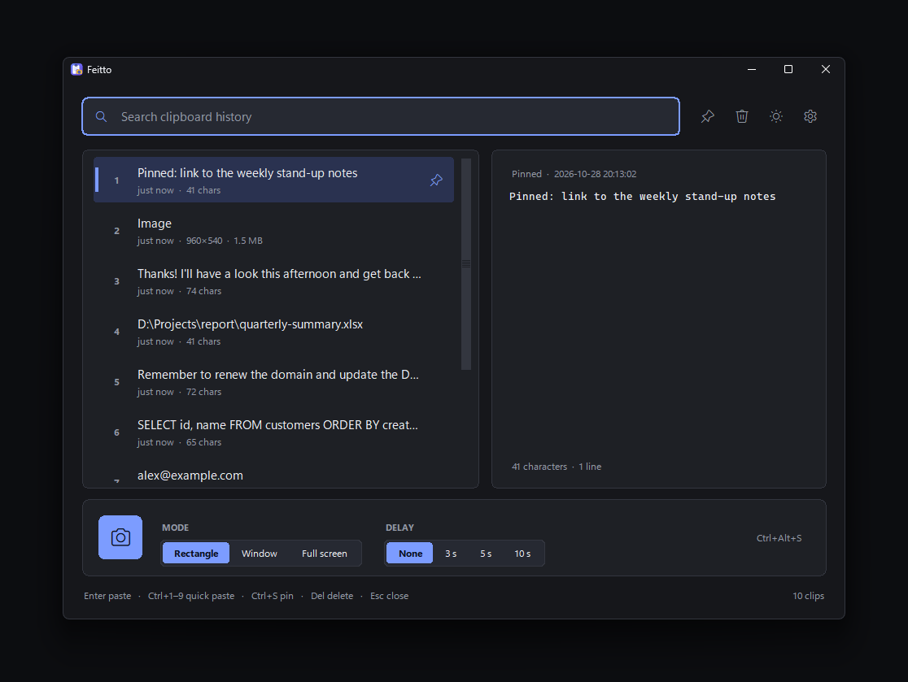
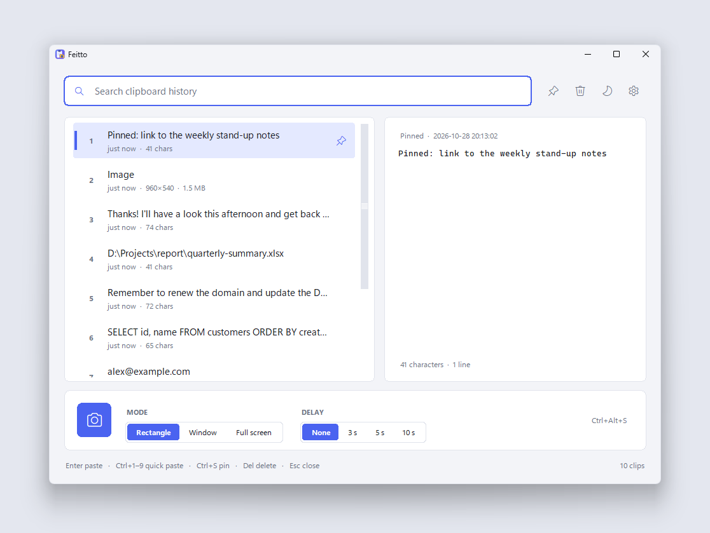
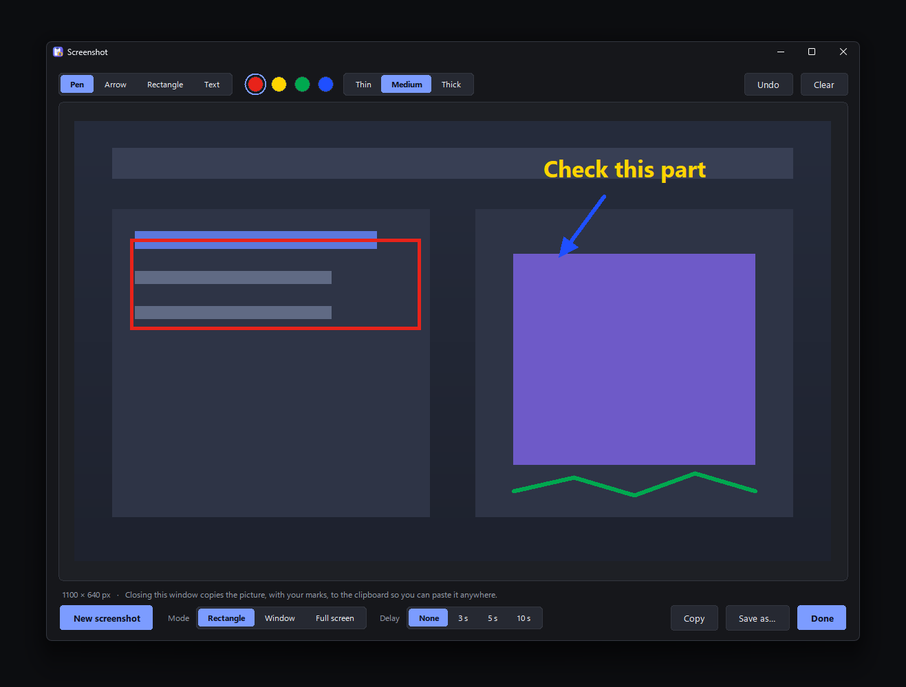
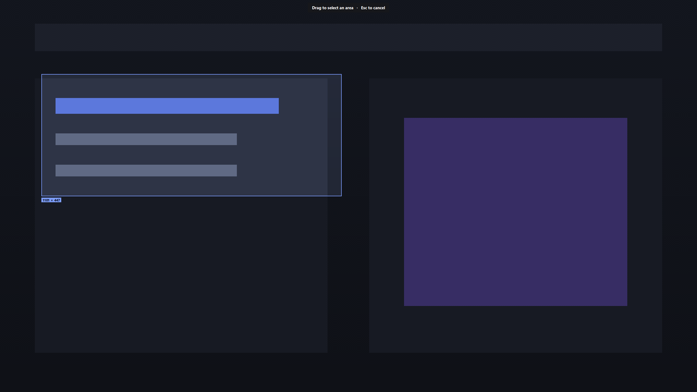
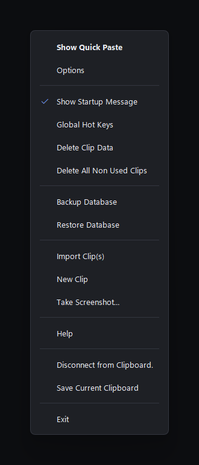
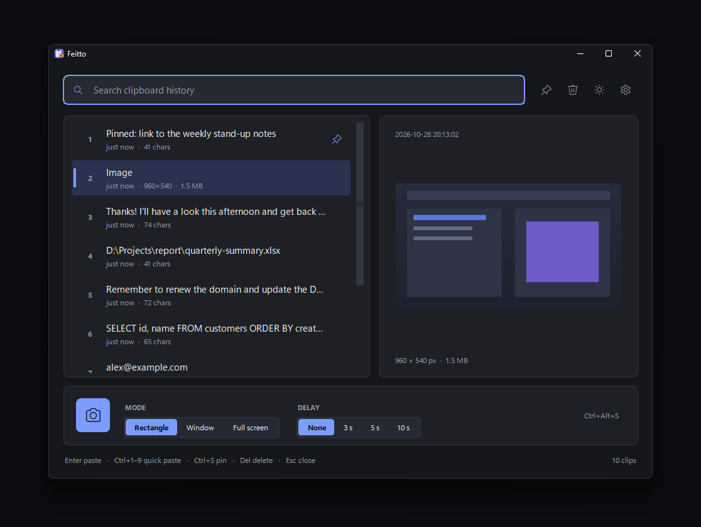
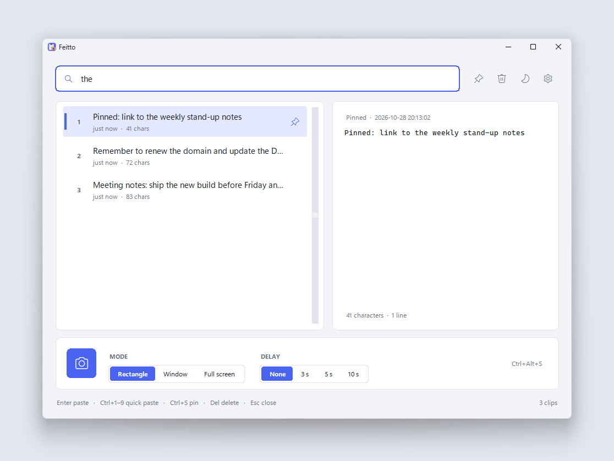
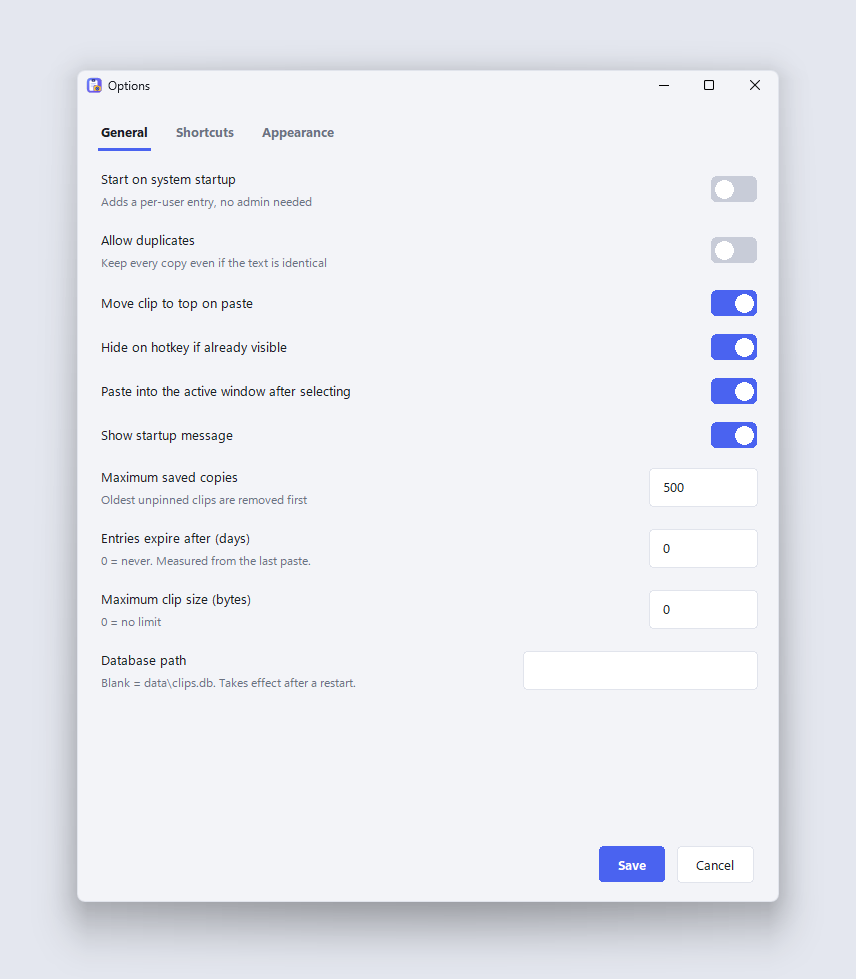
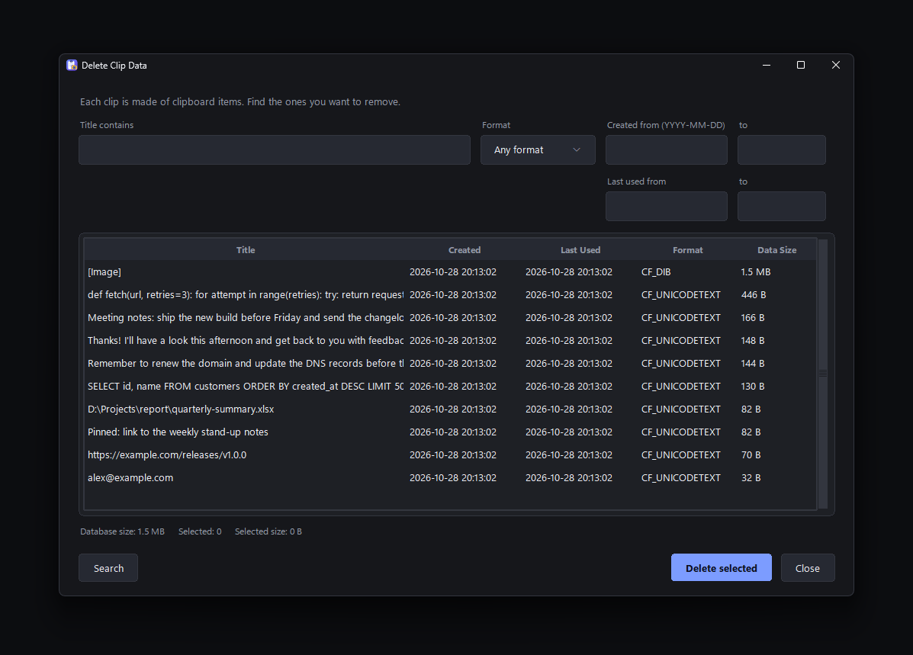

# Feitto

**A portable clipboard history manager and screenshot tool for Windows.**
No installer, no admin rights, no extra packages: copy the folder (or the single `.exe`) anywhere and run it.

Feitto lives in the system tray. Press a hotkey and a quick-paste window appears with everything you copied
recently; pick an item and it is pasted into the app you were using. Need a picture of something? The built-in
screenshot tool captures an area, a window or the whole screen (optionally after a 3, 5 or 10 second delay), lets
you mark it up with arrows, boxes, pen strokes and text notes, and puts the result on the clipboard, ready to paste
into a chat or an email.

<p align="center">
  
  
</p>

## Features

### Clipboard history
- Keeps everything you copy: **text and images**. Identical copies are merged and moved back to the top.
- **Quick-paste window** on a global hotkey (default `Ctrl+Alt+V`): live search, a preview pane (full text, or the
  picture scaled to fit), pin your favourites, delete items, paste with `Enter`, double-click or `Ctrl+1` … `Ctrl+9`.
- **Pinned clips** stay at the top and are never removed automatically.
- **Auto clean-up**: keep the newest *N* clips (500 by default), optionally expire clips after *N* days, and skip
  copies above a size limit.
- Respects password managers: copies flagged "exclude from clipboard history" are never recorded.
- **Disconnect from Clipboard** pauses recording whenever you want; **Save Current Clipboard** stores what is on the
  clipboard right now, even while disconnected.
- Extra global hotkeys: paste one of your **last ten copies** directly, or save the current clipboard.

### Screenshots
<p align="center"></p>

- **Three capture modes:** *Rectangle* (drag an area), *Window* (hover to highlight, click to choose) and
  *Full screen* (all monitors). Works with several monitors, including ones with different scaling: *Full screen*
  captures them all as one picture, and a rectangle can start on one monitor and end on another.
- **Delay:** *None*, *3 s*, *5 s* or *10 s*, with an on-screen countdown, so you can open a menu or a tooltip first.
- Mode and delay sit at the bottom of the main window next to the camera button, and again in the editor next to
  **New screenshot**. The hotkey (default `Ctrl+Alt+S`) and the tray menu capture straight away with those settings.
- **Mark-up editor:** pen, arrow, rectangle and text, in the primary colours (red, yellow, green, blue), three
  thicknesses, undo and clear.
- **Closing the editor always copies the finished picture, marks included, to the clipboard**, and keeps it in your
  history. You can also *Save as…* a PNG.

<p align="center"></p>

### Look and feel
- **Light, Dark or follow Windows** — switch from the sun/moon button or in *Options → Appearance*.
- Rounded widgets, smooth animations (sliding selectors and switches, fading windows, a gliding selection),
  a tray menu and notifications that match your theme, and sharp text on high-DPI screens.

<p align="center">
  
  
</p>

<details>
<summary>More screenshots</summary>
<p align="center">
  
  
</p>
<p align="center">
  
</p>
</details>

### Tools
- **Delete Clip Data** — find items by title, date range or format and delete just their data.
- **Delete All Non Used Clips** — clear everything that is not pinned.
- **Backup / Restore Database** — save your history to a `.fdb` file and load it back later (a safety copy of the
  current history is made before every restore).
- **Import Clip(s)** — turn text files into clips. **New Clip** — type a clip by hand.
- **Global Hot Keys** — shows every hotkey Feitto registered and whether Windows accepted it.
- **Start on system startup** — optional, per-user, no administrator rights needed.

### Portable by design
- Everything Feitto stores lives in a `data` folder **next to the program**: your history (`clips.db`) and your
  settings (`settings.json`). Move or copy the folder and your history comes with it.
- Only one copy runs at a time; starting it again simply brings up the window.
- Nothing is sent anywhere. There is no network access, no account and no telemetry.

## Requirements

| | |
|---|---|
| **Operating system** | Windows 11 (64-bit) — the version it was developed and tested on. Windows 10 should work too; there the borderless menus and notifications simply keep square corners. |
| **To run the `.exe`** | Nothing else. Python is bundled inside the file. |
| **To run from source** | **Python 3.8 or newer** (developed and tested on 3.13) installed with **tkinter** (included in the standard python.org installer; leave "tcl/tk and IDLE" ticked). No third-party packages — Feitto uses only the Python standard library and APIs built into Windows. |
| **Permissions** | A normal user account is enough. No administrator rights, no installation. |

> Because Windows does not let one program send keystrokes to another that runs with higher privileges, Feitto
> cannot paste into windows that were started with **Run as administrator**. Everything else works normally.

## Install and run

### Option 1 — the single `.exe` (easiest)
1. Open the [**Releases**](https://github.com/bgalves/Feitto/releases/latest) page and download `Feitto-…-windows-x64.exe`.
2. Put it in a folder you can write to (for example `Documents\Feitto`) and double-click it.
   A `data` folder is created next to it on first run.
3. Look for the small clipboard-and-camera icon in the notification area (it may be under the `^` arrow). Press
   **Ctrl+Alt+V**, or left-click the icon.

### Option 2 — Python (portable)
1. Install [Python 3.8+](https://www.python.org/downloads/windows/) if you do not have it (keep tkinter selected).
2. Download `Feitto-…-python-portable.zip` from the [Releases](https://github.com/bgalves/Feitto/releases/latest)
   page, or clone this repository, and unzip it anywhere.
3. Double-click **`run.bat`**, or run it yourself:
   ```bat
   pythonw feitto.py
   ```
   (use `python feitto.py` instead if you want to see a console).

To **quit** Feitto: right-click the tray icon → **Exit**. Closing the window only hides it.

### Windows SmartScreen / antivirus
The `.exe` is not code-signed, so Windows SmartScreen or some antivirus programs may warn about it the first time
(*More info → Run anyway*). If you prefer, use Option 2 or build the `.exe` yourself (see below) — the source is
short and readable.

## Using Feitto

| Action | How |
|---|---|
| Open the history | `Ctrl+Alt+V`, or left-click the tray icon |
| Paste an item | `Enter`, double-click, or `Ctrl+1` … `Ctrl+9` for the first nine |
| Move through the list | `↑` `↓` `Page Up` `Page Down` |
| Search | Just start typing |
| Pin / unpin | `Ctrl+S` (or the pin button) |
| Delete an item | `Del` when the search box is empty, or `Ctrl+D` |
| Right-click an item | Paste, pin, delete, and more |
| Close the window | `Esc` — Feitto keeps running in the tray |
| Take a screenshot | Camera button, `Ctrl+Alt+S`, or *Take Screenshot…* in the tray menu |
| Cancel a selection | `Esc` or right-click |
| Undo a mark | `Ctrl+Z` in the editor |
| Switch theme | Sun/moon button, or *Options → Appearance* |
| Quit | Tray icon → **Exit** |

**Tray menu** (right-click the icon): Show Quick Paste · Options · Show Startup Message · Global Hot Keys ·
Delete Clip Data · Delete All Non Used Clips · Backup Database · Restore Database · Import Clip(s) · New Clip ·
Take Screenshot… · Help · Disconnect from Clipboard · Save Current Clipboard · Exit.

### Taking and sharing a screenshot
1. Choose a **Mode** and a **Delay** next to the camera button, then click the camera (or press `Ctrl+Alt+S`).
2. *Rectangle:* drag over the area. *Window:* click the highlighted window. *Full screen:* nothing to do.
3. In the editor, pick a tool and a colour and mark what matters. Use **Undo** if you slip.
4. Click **Done** (or just close the window). The picture, with your marks, is now on the clipboard — paste it
   into a chat, an email or a document.

## Settings

Open *Options* from the tray menu or the gear button. Settings are saved to `data\settings.json`.

| Setting | What it does |
|---|---|
| Start on system startup | Adds/removes a per-user startup entry (no admin rights) |
| Allow duplicates | Keep every copy even when identical |
| Move clip to top on paste | Re-order the list when you paste an item |
| Hide on hotkey if already visible | Pressing the hotkey again closes the window |
| Paste into the active window after selecting | Off = only put the item on the clipboard |
| Maximum saved copies / expire after (days) / maximum clip size | Automatic clean-up rules |
| Database path | Use a different history file (takes effect after a restart) |
| Shortcuts | Hotkeys for the quick-paste window, the screenshot tool, *Save Current Clipboard*, and the "last ten copies" set |
| Appearance | System / Light / Dark, and where the window opens (cursor, centre, last place) |

**Hotkey format:** modifiers `ctrl`, `alt`, `shift`, `win` plus one key, joined with `+` — for example
`ctrl+alt+v` or `ctrl+shift+f9`. `prtsc` can be used on its own, but only if Windows is not already using
the Print Screen key for Snipping Tool (*Settings → Accessibility → Keyboard → Use the Print screen button to open
screen capture*). *Global Hot Keys* in the tray menu shows which hotkeys were accepted.

## Your data and privacy
- History and settings are stored **only on your computer**, in the `data` folder next to Feitto.
- The history is a normal SQLite database and is **not encrypted**. Anything you copy is saved, so use
  *Disconnect from Clipboard*, a size limit, or a password manager that marks its copies as excluded when you handle
  sensitive material, and delete the `data` folder to remove everything.
- Feitto makes no network connections.

## Build the `.exe` yourself
```bat
build_exe.bat
```
This installs [PyInstaller](https://pyinstaller.org/) and produces `dist\Feitto.exe` (a single file, no console
window). Run it from a folder you can write to; the `data` folder is created next to it.

## Troubleshooting
- **Nothing happens when I press the hotkey.** Another program may already use it. Open *Global Hot Keys* from the
  tray menu to see which hotkeys registered, and change them in *Options → Shortcuts*.
- **I cannot find the tray icon.** Click the `^` arrow in the taskbar's notification area; drag the icon out to keep it visible.
- **The first start shows nothing.** That is expected: Feitto starts hidden in the tray. Press `Ctrl+Alt+V`.
- **It will not paste into one particular program.** If that program runs as administrator, Windows blocks it (see above).
- **`pythonw` is not recognised.** Python is not on your `PATH`; reinstall it with *Add python.exe to PATH* ticked, or
  run `py -3 feitto.py`.
- **Windows 10:** the windows work the same; menus and notifications just do not get rounded corners or a shadow.

## Project layout
| File | Purpose |
|---|---|
| `feitto.py` | The application: clipboard capture, history storage, hotkeys, tray, windows and dialogs |
| `widgets.py` | Rounded, animated widgets (buttons, selectors, switches, cards, menus, the clip list) |
| `ui_kit.py` | Themes, colours, animation helpers, image helpers and notifications |
| `snip.py` | Screen capture: full screen, area and window selection, countdown |
| `annotate.py` | The mark-up editor and anti-aliased rendering of the marks |
| `icon.py` | Draws the app icon and writes `feitto.ico` |
| `run.bat` | Starts Feitto without a console window |
| `build_exe.bat`, `version_info.txt` | Build the single-file `.exe` |
| `docs/screenshots/` | The images used in this README |
